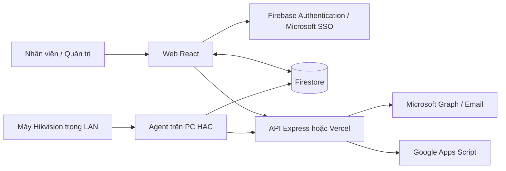

# Bản đồ kỹ thuật dự án ĐKĂN

Khảo sát mã nguồn tại ngày **14/10/2026**, nhánh `main`. Tài liệu này mô tả cấu trúc và hành vi đang được triển khai trong mã nguồn, làm cơ sở cho các lần cập nhật tính năng. Cấu hình và dữ liệu trên hệ thống đang vận hành chưa được kiểm chứng trong lần khảo sát này.

## 1. Kiến trúc tổng thể

Dự án gồm ba phần chạy độc lập nhưng dùng chung quy tắc nghiệp vụ:

| Phần | Công nghệ | Vai trò |
|---|---|---|
| Web, thư mục `src/` | React 19, TypeScript, React Router, Vite 8, Tailwind CSS 4 | Đăng nhập, khai báo nhân sự, đăng ký/hủy ăn, đối soát, lịch sử cá nhân và khảo sát |
| API, thư mục `api/` và `server.ts` | Vercel Functions hoặc Express 5, Microsoft Graph | Gửi email và chuyển dữ liệu hủy ăn sang Google Apps Script |
| Agent, thư mục `agent/` | Node.js, Firebase Admin SDK, Hikvision ISAPI | Đọc lượt chấm thiết bị, ghi Firestore, gửi cảnh báo và mời khảo sát |

Firebase Authentication xác thực tài khoản; Firestore là kho dữ liệu nghiệp vụ chính. Web đọc/ghi Firestore trực tiếp bằng Firebase SDK, không đi qua API Express cho các thao tác đăng ký. Realtime Database được khởi tạo trong `src/lib/firebase.ts`, nhưng chưa thấy luồng nghiệp vụ sử dụng trong mã nguồn khảo sát.

## 2. Cấu trúc và điểm sửa tính năng

| Tệp / thư mục | Trách nhiệm |
|---|---|
| `src/main.tsx`, `src/App.tsx` | Khởi tạo React và khai báo route |
| `src/lib/firebase.ts` | Kết nối Firebase, cấu hình provider Microsoft/Google |
| `src/lib/loginLog.ts` | Ghi nhật ký đăng nhập, thông tin thiết bị/trình duyệt |
| `src/pages/Login.tsx` | Microsoft SSO, kiểm tra email trường, điều hướng sau đăng nhập |
| `src/pages/RegisterStaff.tsx` | Khai báo/sửa tên, mã nhân viên, phòng ban |
| `src/pages/ScheduleMonth.tsx` | Đăng ký tháng, báo hủy theo ngày/bữa, email xác nhận, chuyển hủy sang GAS |
| `src/pages/ScheduleEvent.tsx` | Đọc sự kiện đang mở, đăng ký và email xác nhận |
| `src/pages/Admin.tsx` | Quản trị đăng ký, thống kê, hủy, sự kiện, vi phạm, cấu hình, quyền và nhật ký |
| `src/components/AdminWorkspace.tsx` | Tiêu đề chức năng quản trị, 11 khóa chức năng dùng chung với sidebar, bộ chọn chức năng trên điện thoại |
| `src/components/SchoolSidebar.tsx`, `Navigation.tsx` | Sidebar theo nhóm, menu điện thoại, tài khoản và đăng xuất; quản trị có đủ 11 chức năng |
| `src/lib/useCurrentAccount.ts` | Đọc danh tính Auth và hồ sơ nhân viên, bỏ kết quả của phiên đăng nhập cũ; dùng chung cho Header và trang quản trị |
| `src/components/MealReconciliation.tsx` | Đối soát đăng ký với lượt chấm tự động hoặc Excel HAC; xuất Excel |
| `src/pages/MyMeals.tsx` | Lịch sử cá nhân của tháng này và hai tháng trước |
| `src/pages/MealSurvey.tsx` | Trả lời/sửa khảo sát trong hạn, giữ bản nháp |
| `src/pages/WeeklyMenu.tsx`, `src/components/WeeklyMenuManager.tsx` | Xem thực đơn tuần, quản trị import Excel/xem trước/sửa/lưu |
| `src/lib/weeklyMenuExcel.ts`, `src/components/WeeklyMenuTable.tsx` | Mẫu Excel, đọc workbook và bảng thực đơn thứ 2–6 |
| `agent/lib/weekly-menu.mjs` | Kiểm tra tuần/ngày/món, phân tích dòng Excel, dựng bảng HTML cho email |
| `src/components/SurveyResults.tsx` | Kết quả khảo sát, xu hướng, danh sách chưa trả lời, mở/đóng/gia hạn, xuất Excel |
| `src/components/SurveyBanner.tsx` | Nhắc người có đăng ký ăn và chưa trả lời khảo sát còn mở |
| `src/components/Navigation.tsx`, `Header.tsx`, `Footer.tsx`, `src/index.css` | Điều hướng và giao diện dùng chung |
| `src/pages/Dashboard.tsx` | Tổng quan cá nhân: thông tin hồ sơ và lối truy cập các chức năng, không dùng số liệu mẫu cố định |
| `agent/lib/meal-rules.mjs` | Quy tắc suất ăn dùng chung giữa đối soát, lịch sử cá nhân và cảnh báo |
| `agent/lib/projection.mjs` | Gán lượt chấm theo mã nhân viên trên đơn sang UID tài khoản |
| `agent/lib/sync-merge.mjs`, `isapi-paging.mjs` | Bảo toàn dữ liệu từng máy, kiểm tra phân trang và độ đầy đủ |
| `agent/lib/alert-plan.mjs` | Lập danh sách cảnh báo và kiểm tra điều kiện dừng gửi |
| `agent/lib/survey.mjs` | Bộ câu hỏi, mã đáp án, tuần khảo sát và khung nhận trả lời |
| `agent/lib/survey-plan.mjs` | Lập kế hoạch gửi lời mời, gửi bù, khóa gửi và trạng thái |
| `agent/sync-checkins.mjs`, `survey-invite.mjs` | Điều phối thiết bị/Firestore/API cho hai công việc agent |
| `api/meal-alerts.ts`, `api/_lib/msgraph.ts` | Xác thực agent, dựng thư, gửi Microsoft Graph, phân loại lỗi gửi |
| `api/send-email.ts`, `api/gas.ts`, `server.ts` | Email từ web, tích hợp GAS và server local |
| `firestore.rules` | Phân quyền và kiểm tra dữ liệu ở Firestore |
| `agent/test/` | Kiểm thử nghiệp vụ và các điều kiện an toàn của agent |
| `agent/README.md` | Hướng dẫn cài agent, Task Scheduler, cấu hình, vận hành và xử lý lỗi |

Route được khai báo tại `src/App.tsx`: `/login`, `/register`, `/schedule`, `/events`, `/dashboard`, `/quantri`, `/cham-an`, `/khao-sat`, `/thuc-don`. Route `/` chuyển tới `/login`. Việc kiểm tra phiên/quyền hiện nằm trong từng trang; chưa có thành phần bảo vệ route chung.

## 3. Các luồng nghiệp vụ

### Đăng nhập và hồ sơ

1. Người dùng đăng nhập Microsoft qua Firebase Authentication. Luồng giao diện hiện kiểm tra tên miền `hoangmaistarschool.edu.vn`.
2. Kết quả đăng nhập thành công hoặc bị từ chối được ghi vào `login_logs`.
3. Hồ sơ được lưu tại `staff/{uid}`. Form kiểm tra mã nhân viên dạng `10xxxx`.
4. Quyền quản trị được kiểm tra ở giao diện và Firestore rules, dựa trên tài khoản cố định hoặc collection `admins`.

### Đăng ký tháng và hủy ăn

- Quản trị mở/đóng đăng ký tháng và đặt hạn ở `settings/monthlyConfig`, `settings/monthlyExpiry`.
- Chọn ăn sáng đồng nghĩa có cả ăn trưa; có lựa chọn chỉ ăn trưa. Số suất được tính theo thứ 2–6; tháng hiện tại bắt đầu từ ngày đăng ký, tháng tương lai bắt đầu ngày 01.
- Mỗi tài khoản có một đơn tháng tại `registrations/{uid}_{YYYY-MM}`, gồm thông tin hồ sơ tại lúc đăng ký, số suất, `firstMealDate` và thời điểm nộp.
- `blocked_users/{YYYY-MM}` chứa danh sách email bị chặn đăng ký tháng đó.
- Hủy ăn theo ngày, chọn sáng/trưa/cả hai, lý do và nhà ăn. Mỗi ngày có một document `cancel_registrations/{uid}_{YYYY-MM-DD}`.
- Theo form hiện tại: trước 16:00 có thể hủy từ ngày mai; từ 16:00 chỉ hủy từ ngày kia. `settings/cancelConfig.extendUntil` cho phép nới hạn.
- Đăng ký/hủy được ghi Firestore trước khi gọi email. Hủy ăn còn gọi `/api/gas` cho từng ngày; thất bại của tích hợp cần được đối chiếu riêng với bản ghi đã lưu.

### Chấm ăn và đối soát

1. Thiết bị ghi sự kiện nhận diện theo mã nhân viên và thời gian.
2. Agent đọc sự kiện qua ISAPI, chuẩn hóa giờ/ngày, gộp theo từng máy và giữ dữ liệu cũ khi một máy lỗi hoặc không trả đủ dữ liệu.
3. Agent ghi `checkins/{YYYY-MM-DD}` cho toàn trường và tạo `meal_taps/{uid}/months/{YYYY-MM}` cho từng tài khoản.
4. Ánh xạ mã sang tài khoản dựa trên **mã chụp trên đơn đăng ký của tháng**, theo `projection.mjs`. Không sử dụng mã hồ sơ hiện tại để chuyển lượt chấm sang tài khoản khác.
5. `settings/checkinSync` ghi tình trạng đồng bộ và mức độ phủ dữ liệu theo ngày. Chỉ đánh dấu đủ dữ liệu khi tất cả máy phủ ngày đó và dữ liệu cá nhân đã được cập nhật.
6. Quản trị đối soát đăng ký, báo hủy, ngày nghỉ và lượt chấm. Người dùng chỉ đọc lượt chấm của UID mình trên trang `/cham-an`.
7. Excel HAC vẫn là nguồn nhập dự phòng trong tab đối soát; nhập Excel không thay thế công việc đồng bộ cá nhân của agent.

### Email cảnh báo

Sau đồng bộ, nếu chạy với `--send-alerts`, agent xác định người đã đăng ký nhưng thiếu lượt chấm. Agent kiểm tra giờ gửi, dữ liệu đủ máy, ngày có suất ăn, mã trùng/loại trừ, báo hủy và các ngưỡng bất thường trước khi gửi.

Email lấy địa chỉ từ tài khoản Firebase Authentication. Nhật ký `meal_alerts/{date}_{uid}` ngăn gửi lại cho người đã gửi trong ngày; khóa file ngăn hai lần đồng bộ chạy đồng thời trên cùng máy. Cảnh báo nên vận hành trên một máy agent, vì khóa này không phối hợp giữa nhiều máy.

### Khảo sát hằng tuần

- `agent/lib/survey.mjs` định nghĩa 5 câu lựa chọn và 3 câu văn bản; món yêu thích là bắt buộc.
- Mã tuần là ngày thứ 2, `YYYY-MM-DD`. Mặc định mở lúc 15:00 thứ 6, đóng 12:00 thứ 2 kế tiếp, theo giờ Việt Nam.
- Agent xác định người có đăng ký ăn trong tuần, bỏ trường hợp không hợp lệ/loại trừ; tuần nghỉ hoàn toàn không gửi mời.
- Thư mời gửi theo Bcc, tối đa 400 người trong một thư. Trạng thái đã gửi và không rõ đã gửi được ghi riêng, để không tự gửi lại thư có khả năng đã đi.
- Khảo sát có khóa file trên máy và lease Firestore để phối hợp giữa các máy.
- Mỗi UID có một phản hồi mỗi tuần, được sửa trong hạn. Firestore dùng giờ máy chủ kiểm tra khoảng `[opensAt, closesAt)`.
- Quản trị đọc kết quả, xuất Excel, mở sớm, gia hạn hoặc đóng khảo sát. Khảo sát có thông tin người trả lời.

### Thực đơn tuần (cập nhật 14/10/2026)

- Nhóm Dinh dưỡng dùng **Quản trị → Thực đơn tuần** (`/quantri?tab=menu`) để tải mẫu Excel, import, xem trước, sửa và lưu bảng thứ 2–6. Nhóm Dinh dưỡng cần tài khoản có quyền quản trị hiện có. Bản đang chỉnh được giữ khi chuyển tab quản trị; chuyển tuần hoặc đóng/tải lại trang có cảnh báo nếu chưa lưu.
- Bảng có bữa sáng và sáu mục bữa trưa theo mẫu. Mỗi document `weekly_menus/{weekId}` có `version: 1`, năm phần tử `days` từ thứ 2 đến thứ 6, ghi chú và metadata người/thời gian cập nhật. Chỉ lưu văn bản món ăn; file Excel được đọc tại trình duyệt.
- Nhân viên đã đăng nhập xem tại `/thuc-don`; link `/thuc-don?tuan=YYYY-MM-DD` mở đúng tuần. File import phải có các ngày khớp tuần đang chọn.
- Agent khảo sát đọc thực đơn đúng tuần và chuyển dữ liệu đã kiểm tra vào request `survey-invite`. API dựng bảng HTML có escape nội dung để hiển thị ngay trong email, kèm link xem trên web.
- Chưa có thực đơn thì vẫn gửi khảo sát với link xem; lỗi đọc hoặc document hỏng thì dừng trước gửi. Thư cũ giữ bảng ở thời điểm gửi, web hiển thị bản cập nhật mới.
- Triển khai cần cập nhật web/API, Firestore rules và script khảo sát + `agent/lib/` trên PC HAC; không phát sinh biến môi trường mới.

## 4. Quy tắc cần giữ đồng nhất

Các quy tắc đối soát chính nằm trong `agent/lib/meal-rules.mjs`:

| Quy tắc | Hành vi hiện tại |
|---|---|
| Khung bữa sáng | 05:00–08:00, tính cả hai đầu |
| Khung bữa trưa | 10:00–13:30, tính cả hai đầu |
| Nhiều lần chấm một bữa | Giữ lượt sớm nhất trong khung |
| Ngoài khung | Ghi nhận riêng, không tính vào bữa |
| Ngày có suất ăn | Thứ 2–6, trừ `settings/mealOffDays` |
| Ngày bắt đầu | Xét `firstMealDate` và thời điểm đăng ký; nộp sau khi bữa kết thúc không tạo nghĩa vụ ăn bữa đã qua |
| Ăn trước, đăng ký sau cùng ngày | Có lượt chấm thì có thể được tính đã đăng ký theo `countsAsRegistered` |
| Dữ liệu đơn cũ | Có suất sáng nhưng trưa bằng 0 được chuẩn hóa thành có suất trưa |
| Hủy ăn | Ưu tiên UID; dữ liệu rất cũ không có UID mới khớp theo mã nhân viên |
| Mã nhân viên | Chuẩn hóa khoảng trắng/chữ hoa; mã trường dùng cho đối soát có 6 chữ số |
| Mã trùng | Xét từ ngày đơn thứ hai có hiệu lực; từ ngày đó không tự gán lượt chấm/kết luận cho các tài khoản trùng |
| Kết luận thiếu chấm | Bữa đã kết thúc **và** có lần đồng bộ đủ máy sau giờ kết thúc bữa; chưa đủ thì `pending` |
| Múi giờ | Hàm dùng chung sử dụng `Asia/Ho_Chi_Minh` |

Khi sửa khung giờ hoặc cách tính đăng ký/hủy, bắt đầu ở `meal-rules.mjs`, rồi kiểm tra đối soát, cá nhân và cảnh báo. Đây là module thuần chạy được cả Node và trình duyệt, nên không thêm phụ thuộc riêng của một môi trường.

Khi đổi câu hỏi/mã đáp án khảo sát, cập nhật `survey.mjs`, tăng phiên bản khi thích hợp và đồng bộ `validSurveyAnswers` trong `firestore.rules`. Công thức tuần trong `api/_lib/survey-week.ts` cần khớp với module khảo sát của agent; các bài test hiện có kiểm tra một phần các hợp đồng này.

## 5. Hợp đồng dữ liệu Firestore

| Document / collection | Nội dung chính | Quyền truy cập từ web |
|---|---|---|
| `staff/{uid}` | Hồ sơ nhân viên | Chính chủ/quản trị |
| `admins/{id}` | Email quản trị | Người đăng nhập đọc; quản trị ghi |
| `registrations/{uid}_{YYYY-MM}` | Đăng ký tháng, số suất, ngày bắt đầu, hồ sơ tại lúc nộp | Chính chủ/quản trị |
| `cancel_registrations/{uid}_{date}` | Báo hủy, bữa, lý do, nhà ăn | Quyền hiện tại cần xem trực tiếp trong rules |
| `events/{id}` | Tên, trạng thái mở, hạn đăng ký | Người đăng nhập đọc; quản trị ghi |
| `event_registrations/{uid}_{eventId}` | Lựa chọn tham gia và hồ sơ | Quyền hiện tại cần xem trực tiếp trong rules |
| `blocked_users/{YYYY-MM}` | Email bị chặn | Người đăng nhập đọc; quản trị ghi |
| `settings/{id}` | Cấu hình nghiệp vụ, đồng bộ và loại trừ | Người đăng nhập đọc; quản trị ghi |
| `checkins/{date}` | Lượt chấm toàn trường, gộp và riêng từng máy | Quản trị đọc; client không ghi |
| `meal_taps/{uid}/months/{month}` | Giờ chấm riêng của tài khoản | Chính chủ/quản trị đọc; client không ghi |
| `meal_alerts/{date}_{uid}` | Nhật ký cảnh báo | Quản trị đọc; client không ghi |
| `weekly_menus/{weekId}` | Thực đơn 7 mục × 5 ngày, ghi chú và metadata | Người đăng nhập đọc; quản trị ghi theo cấu trúc được rules kiểm tra |
| `login_logs/{id}` | Tài khoản, kết quả, thời gian, thiết bị | Người dùng tạo log UID mình; quản trị đọc/xóa |
| `meal_surveys/{weekId}` | Lịch nhận trả lời, trạng thái gửi lời mời | Người đăng nhập đọc; quản trị ghi |
| `meal_surveys/{weekId}/responses/{uid}` | Đáp án và hồ sơ người trả lời | Chính chủ đọc/ghi trong hạn; quản trị đọc/xóa |
| `meal_surveys/{weekId}/private/{id}` | Danh sách mời, trạng thái từng email, khóa gửi | Quản trị đọc; client không ghi |

Các document cấu hình thường dùng: `monthlyConfig`, `monthlyExpiry`, `cancelConfig`, `mealOffDays`, `reconcileExcludes`, `checkinSync`. Hai cấu hình tháng đầu dùng khóa `MM`; đơn đăng ký và danh sách chặn dùng `YYYY-MM`.

Agent dùng Firebase Admin SDK và không chịu các giới hạn client trong `firestore.rules`. Khi sửa dữ liệu do agent tạo, cần kiểm tra bộ lọc và phép ánh xạ trong agent ngoài rules của web.

## 6. API và triển khai

| API POST | Công việc | Xác thực trong mã hiện tại |
|---|---|---|
| `/api/send-email` | Gửi tiêu đề/HTML/người nhận do web truyền | Chưa kiểm tra người gọi |
| `/api/gas` | Chuyển JSON hủy ăn sang Google Apps Script | Chưa kiểm tra người gọi |
| `/api/meal-alerts` | Cảnh báo, thông báo quản trị và lời mời khảo sát | Bearer `MEAL_ALERT_SECRET`, kiểm tra dữ liệu/người nhận |

Thư cảnh báo/khảo sát được server dựng từ dữ liệu đã kiểm tra. Secret tối thiểu 32 ký tự; địa chỉ nhận thuộc tên miền trường; người nhận thông báo quản trị phải nằm trong danh sách cấu hình phía server. Helper Microsoft Graph có timeout và phân biệt lỗi chắc chắn chưa gửi với lỗi có thể đã gửi.

Biến môi trường cần cho email: `MS_GRAPH_TENANT_ID`, `MS_GRAPH_CLIENT_ID`, `MS_GRAPH_CLIENT_SECRET`, `MS_GRAPH_SENDER`. Cảnh báo/khảo sát dùng thêm `MEAL_ALERT_SECRET`, `MEAL_ALERT_CC`, `MEAL_ALERT_ADMINS`, `PUBLIC_APP_URL`. Xem `.env.example` để biết ý nghĩa và giá trị mẫu.

- **Local:** `npm run dev` chạy `tsx server.ts`, cổng 3000, Express tích hợp Vite middleware.
- **Build:** `npm run build` tạo web trong `dist/` và bundle server `dist/server.cjs`.
- **Express production:** đặt `NODE_ENV=production` trước `npm start`; script `start` chưa tự đặt biến này. `npm run preview` chỉ phục vụ bản web build, không khởi động các API Express.
- **Vercel:** `api/*.ts` là các function riêng; `vercel.json` rewrite các đường dẫn SPA về `index.html`.
- **Firebase:** `firebase.json` hiện cấu hình Firestore rules; `npm run deploy:rules` triển khai rules lên project được cấu hình.

Handler `/api/meal-alerts` được Express nhập trực tiếp từ `api/meal-alerts.ts`. Hai API còn lại có code riêng trong `server.ts` và `api/`; sửa chúng cần kiểm tra cả hai cách triển khai.

## 7. Agent và lịch vận hành

Lịch dưới đây được mô tả trong `agent/README.md`; chưa kiểm tra Task Scheduler trên máy HAC thực tế:

| Công việc | Lịch giờ Việt Nam | Tham số |
|---|---|---|
| Đồng bộ sáng | Thứ 2–6, 08:15 | `--quiet --days 1` |
| Đồng bộ trưa và cảnh báo | Thứ 2–6, 13:45; lặp 15 phút trong 1 giờ | `--quiet --days 1 --send-alerts` |
| Đồng bộ bù | Hằng ngày, 22:00 | `--quiet` |
| Mời khảo sát | Thứ 6, 15:00; các trigger gửi bù buổi sáng và khi khởi động máy | `khao-sat-bua-an.bat --quiet` |

Khung gửi bù tự động khảo sát từ 15:00 thứ 6 đến trước 12:00 thứ 2 kế tiếp, còn ít nhất 1 giờ tới hạn; trạng thái không rõ đã gửi không tự gửi lại. Xem README để biết các trường hợp chạy tay/gia hạn và ý nghĩa mã thoát.

Thông tin thiết bị và khóa thật nằm trong `agent/config.json`, `agent/firebase-key.json`, đã được `.gitignore` loại khỏi Git. Ví dụ cấu hình nằm trong `agent/config.example.json`. Bộ script cần được chép cùng toàn bộ `agent/lib/` sang máy HAC sau những thay đổi quy tắc chung.

## 8. Kiểm chứng của lần khảo sát

| Kiểm tra | Kết quả |
|---|---|
| `npm run lint` | Đạt: TypeScript `tsc --noEmit` |
| `npm run build` | Đạt: web và server build thành công |
| `node --test --test-isolation=none` tại `agent/` | Đạt: 136/136 tests |
| Browser và hệ thống thật | Chưa kiểm tra luồng tương tác hay dữ liệu đang vận hành |

Runtime local: Node.js `v24.12.0`, npm `11.6.2`. Sandbox ban đầu chặn spawn của build/test bằng `EPERM`; build chuẩn đã chạy thành công khi được thực thi ngoài sandbox, test chạy được khi tắt tách tiến trình. Cảnh báo build hiện có: bundle JavaScript khoảng 1,565 kB, gzip khoảng 465 kB, vượt ngưỡng cảnh báo 500 kB.

Các bài test tập trung vào quy tắc suất ăn, cảnh báo, độ phủ thiết bị, phân trang, khóa chạy, hợp nhất dữ liệu, ánh xạ tài khoản, CLI, endpoint và lập kế hoạch khảo sát. Chúng không thay thế kiểm tra thiết bị Hikvision, Firestore rules bằng emulator, email thật hoặc giao diện trình duyệt.

Cập nhật thực đơn ngày 14/10/2026: bổ sung kiểm thử parser thực đơn, mẫu Excel `.xlsx`/`.xls`, hệ ngày 1904, sai tuần, giới hạn tệp/hàng, HTML email và API với Microsoft Graph giả lập. Tổng bộ kiểm thử hiện tại **158 bài**. `npm test` ở gốc chạy đúng các file test nghiệp vụ/Excel, không chạy script gửi thư thử `test-email.cjs`. Giao diện thực đơn đã được xem trên máy tính và điện thoại 360px bằng bản QA chỉ dùng dữ liệu và thao tác lưu giả lập; hộp chọn file của trình duyệt QA không mở được, nên luồng import được xác minh bằng các bài roundtrip Excel. Firestore rules chưa được chạy qua emulator hay deploy trong lần cập nhật này.

Cập nhật quyền thực đơn ngày 14/10/2026: kiểm tra Rules API cho thấy rules production của `dkan-4b061` chưa có `weekly_menus`. Đã đối chiếu với rules trong repo, kiểm tra biên dịch không có lỗi, chạy 6 giả lập quyền (hai super admin được đọc/xóa, nhân viên thường không được xóa, người chưa đăng nhập không được đọc) và triển khai ruleset `02b97357-1b95-43fa-b841-44f19764ea59` lúc 15:04:08 giờ Việt Nam. Đã đọc lại release `cloud.firestore` và xác minh nội dung khớp `firestore.rules`; không ghi/xóa thực đơn thật để thử quyền. `src/lib/adminAccess.ts` nay là danh sách quản trị cao nhất dùng chung cho trang quản trị và menu điều hướng, chuẩn hóa email hoa/thường và khoảng trắng; regression test đối chiếu danh sách này với rules. Tổng kiểm thử **161/161 đạt**, TypeScript và build đạt. Khi thay rules, cần triển khai Firebase riêng vì Vercel chỉ triển khai web/API.

Cập nhật giao diện quản trị ngày 14/10/2026: chừa 64px cho Header ở mọi kích thước để tiêu đề không bị che; nhóm menu thành Suất ăn, Dinh dưỡng và Hệ thống, hiển thị đủ 11 chức năng với mô tả và trạng thái chọn. Thông tin tài khoản ưu tiên hồ sơ `staff/{uid}`, dùng danh tính Auth khi hồ sơ chưa có hoặc đọc lỗi, ghi rõ các trường chưa cập nhật; vai trò cao nhất chỉ dựa email Auth. Header nhận cùng hồ sơ từ Admin để không đọc lặp. QA trình duyệt dùng đúng các thành phần với hồ sơ mẫu: 320/360/768/1024/1280/1920px không tràn ngang/cắt menu/che tiêu đề; chọn 11 chức năng, URL/Back, tên/email dài, hộp thông tin/Escape/focus đều đạt. Không thay thao tác ghi dữ liệu nghiệp vụ trong lần chỉnh giao diện này.

Cập nhật toàn bộ giao diện ngày 15/10/2026 theo mẫu ứng dụng Nhân sự nhà trường: sidebar đầy chiều cao, logo đỏ, nền xám sáng/thẻ trắng, hành động xanh và nhãn trạng thái nhẹ. Header chỉ cố định trên điện thoại và trang hồ sơ, các trang nội bộ chừa 256px cho sidebar ở desktop. Đăng nhập, hồ sơ, đăng ký/hủy, sự kiện, chấm ăn, thực đơn, khảo sát và quản trị dùng cùng phong cách. Tổng quan bỏ các số liệu/thực đơn/hạn mẫu cố định; thông tin hồ sơ được đọc từ tài khoản và các thẻ chức năng dẫn tới trang nghiệp vụ. Sidebar có nhóm Cá nhân/Dinh dưỡng/Quản trị; chế độ quản trị chia 11 mục theo nghiệp vụ. Điện thoại dùng 4 nút và drawer chứa toàn bộ chức năng, dialog tài khoản tập trung ở Navigation. Bản nhập thực đơn vẫn giữ khi chuyển mục quản trị. Không thay quy tắc suất ăn, schema Firestore, cấu hình gửi thư hoặc mẫu email.

Kiểm tra lần cập nhật 15/10: TypeScript, build và 161 kiểm thử đều đạt. QA dùng đúng toàn bộ ứng dụng với Firebase giả lập, không kết nối/ghi dữ liệu thật: 9 trang ở 320/768/1280px, 7 trang nội bộ ở 1920px; đủ 11 mục quản trị và bộ chọn trên điện thoại; menu drawer/Escape, dialog tài khoản, bản nháp thực đơn khi chuyển mục đều hoạt động. Đã xử lý tràn ban đầu do font icon chưa tải bằng cách giữ sẵn bề rộng icon. Các bảng lớn vẫn cuộn ngang bên trong khung.

## 9. Các điểm cần xem xét khi cập nhật

Đây là các khác biệt nhìn thấy trong mã nguồn, chưa được sửa trong lần khảo sát. Cần đối chiếu yêu cầu nghiệp vụ khi xử lý:

1. **Thống kê và số suất:** `ScheduleMonth.tsx` đếm thứ 2–6 nhưng chưa trừ `mealOffDays`. Thống kê ngày tại `Admin.tsx` chỉ xét số suất lớn hơn 0 và báo hủy, chưa xét `firstMealDate`/ngày nghỉ như đối soát. Vì vậy đăng ký giữa tháng hoặc ngày nghỉ có thể cho số liệu khác nhau giữa các màn hình.
2. **API từ web:** `api/send-email.ts` và `api/gas.ts`, cùng các route tương ứng trong `server.ts`, chưa xác thực người gọi. Nên ưu tiên kiểm tra khi cập nhật tích hợp email/GAS.
3. **Rules báo hủy/sự kiện:** điều kiện `resource == null` chưa ràng buộc UID và ID document của bản ghi mới như nhánh đăng ký tháng. Cần bổ sung kiểm tra quyền sở hữu khi chỉnh rules cho hai luồng này.
4. **Menu quản trị:** `Navigation.tsx` có một tài khoản quản trị cố định, trong khi `Admin.tsx` và rules có ba; hiển thị menu có thể khác quyền thực tế nếu thiếu document `admins` tương ứng.
5. **Đăng ký sự kiện và hủy nhiều tháng:** form sự kiện kiểm tra đăng ký lặp dựa trên sự kiện mở đầu tiên; form hủy tải đơn tháng của ngày đầu trong danh sách. Cần xem lại khi bổ sung đăng ký từng sự kiện hoặc hủy xuyên tháng.
6. **Khác biệt local/Vercel:** GAS trong Express kiểm tra HTTP upstream, bản Vercel hiện trả thành công sau fetch kể cả khi upstream trả lỗi. Cần thống nhất khi sửa xử lý lỗi.
7. **Dashboard và hiệu năng:** dashboard còn số liệu mẫu; các trang quản trị/khảo sát lớn và build chưa tách chunk theo route. Đây là các điểm sửa khi cần dashboard thật hoặc tối ưu tải trang.
8. **Múi giờ và cấu hình tháng:** form đăng ký/hủy dùng giờ máy, module dùng chung dùng giờ Việt Nam; khóa cấu hình `MM` không phân biệt năm. Cần đánh giá khi hỗ trợ người dùng ở múi giờ khác hoặc quản lý nhiều năm.
9. **Tài liệu agent:** câu mô tả việc gán lượt chấm trong `agent/README.md` đã được cập nhật ngày 14/10/2026: chỉ gán theo đơn đăng ký tháng; người không có đơn tháng không được gán lượt chấm cá nhân, khớp `projection.mjs`.

Khi nhận yêu cầu mới, xác định màn hình và dữ liệu liên quan, cập nhật quy tắc chung nếu có, kiểm tra quyền Firestore/API và tác động tới agent, rồi chạy các kiểm tra phù hợp. Sau thay đổi, cập nhật tài liệu này để bản đồ tiếp tục phản ánh mã nguồn.
